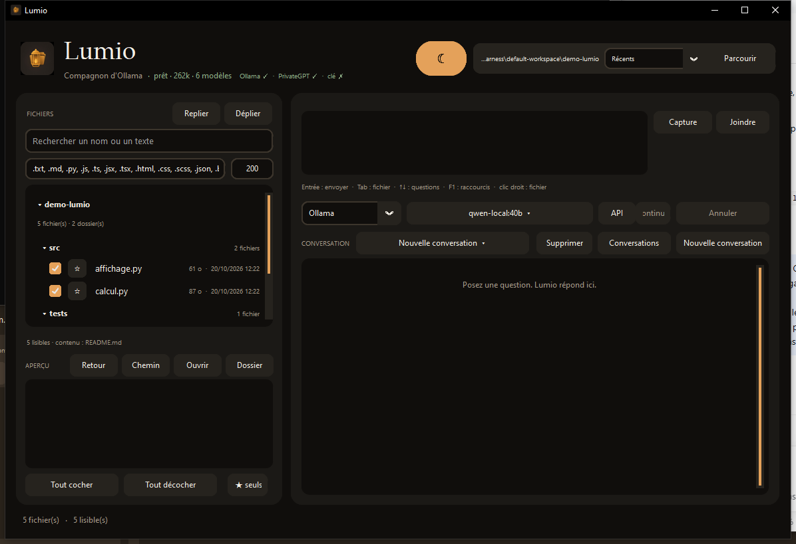
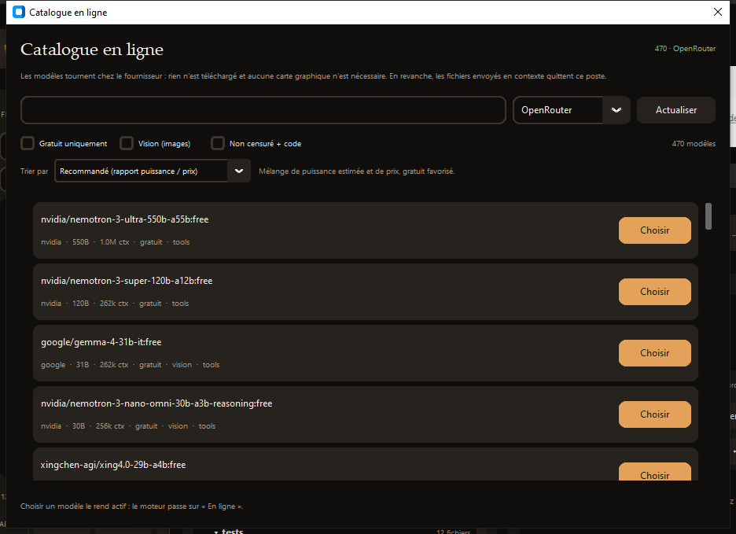

# Lumio-ollama

**Assistant de bureau pour travailler sur un dossier avec un modèle local : il lit, modifie et — surtout — vérifie ce qu'il produit.**



`Licence MIT` · `Python 3.11+` · `Windows 10/11`

Lumio a été conçu au départ pour permettre à Ollama de modifier les fichiers
présents sur un disque dur, sans quitter une interface graphique. Il parle à
Ollama en local, mais aussi à un modèle en ligne (OpenRouter, Groq, DeepSeek…)
quand la tâche dépasse ce que ta machine peut faire.

## Ce qui le distingue

La plupart des assistants s'arrêtent quand ils ont écrit du code. Lumio
**referme la boucle** :

1. il propose des fichiers sous forme de diffs ;
2. tu acceptes (ou il applique, si tu l'as autorisé) ;
3. il **exécute la commande de vérification** du dossier ;
4. si ça échoue, il **réinjecte la sortie d'erreur** au modèle et corrige ;
5. il recommence, dans une limite que tu fixes.

Chaque écriture est archivée : on peut revenir à la version précédente.

## Fonctionnalités

| Fonction | Comment |
|---|---|
| Discuter d'un dossier | fichiers cochés = contexte envoyé au modèle |
| Voir l'arborescence | panneau **FICHIERS**, dossiers dépliables, état mémorisé |
| Choisir un modèle local | bouton du modèle → *Modèles* |
| Chercher un modèle en ligne | *Modèles* → **Catalogue en ligne** (470 modèles, tarifs, gratuits) |
| Trier ces modèles | *Recommandé*, *Puissance estimée*, *Prix*, *Contexte*, *Récent*, *Nom* |
| Vérifier le code produit | barre d'actions → **Vérifier** |
| Donner des outils au modèle | blocs `rechercher:` / `lire:` |
| Revenir à une version | *Palette* → **Versions des fichiers** |
| Suivre le coût | tokens et dollars dans l'en-tête et dans *Coût et tokens* |
| Tout piloter au clavier | `Ctrl+K` (palette), `Ctrl+Maj+F` (recherche) |



## Prérequis

- **Windows 10/11** — le chiffrement de la clé API utilise le DPAPI de Windows.
- **Python 3.11+** — [python.org](https://www.python.org/downloads/), en cochant
  « Add python.exe to PATH ».
- **Ollama** pour les modèles locaux — [ollama.com](https://ollama.com/download).
  Facultatif si tu utilises uniquement des modèles en ligne.

## Installation

```bat
git clone https://github.com/<ton-compte>/Lumio-ollama.git
cd Lumio-ollama
python -m pip install -r requirements.txt
```

Puis double-clique **Lumio.lnk** (ou `Lumio.bat`). Le lanceur démarre Ollama si
besoin, vérifie les dépendances, puis ouvre l'interface.

Sans Git : télécharge le ZIP du dépôt, décompresse-le, puis lance les mêmes
commandes dans le dossier.

## Démarrage rapide

1. **Parcourir** → choisis le dossier du projet.
2. Coche les fichiers que le modèle a le droit de lire.
3. Clique sur le modèle (en haut) et choisis-en un.
4. Pose ta question. Les fichiers proposés apparaissent en diffs à accepter.
5. Pour un travail complet : *Réglages* (`Ctrl+K`) → **Vérifier automatiquement**
   et, si tu veux vraiment l'autonomie, **Appliquer les fichiers sans clic**.

## Mode agent (les réglages qui comptent)

| Réglage | Effet |
|---|---|
| Vérifier automatiquement | exécute la commande de vérification après chaque écriture |
| Commande de vérification | vide = détection (`tests/run_tests.py`, pytest, `npm test`, sinon `py_compile`) |
| Tentatives de correction | nombre de reprises automatiques (0-5, défaut 2) |
| Appliquer sans clic | écrit les fichiers sans confirmation, borné en fichiers et en octets |
| Budget $ par question | stoppe les reprises automatiques au-delà du montant |
| Commandes autorisées | liste blanche, une commande par ligne |
| Outils du modèle | autorise `rechercher:` et `lire:` |
| Routage | choix automatique local / en ligne selon la difficulté |

## Confidentialité

- Avec un modèle **local**, rien ne quitte la machine.
- La clé API est **chiffrée avec le DPAPI** de Windows et stockée dans
  `%APPDATA%\Lumio\session.json`, jamais dans le dépôt.
- Les conversations, le journal de coût et les versions de fichiers vivent dans
  `%APPDATA%\Lumio` : supprimer ce dossier remet Lumio à zéro.
- Avec un modèle **en ligne**, le contenu des fichiers cochés part chez le
  fournisseur. Lumio le rappelle dans l'interface.

## Sécurité

Lumio écrit des fichiers dans le dossier choisi et exécute des commandes. Les
garde-fous sont volontaires :

- écritures limitées au dossier sélectionné (chemins vérifiés) ;
- commandes filtrées par liste blanche, enchaînements `&&`, `|`, `>`, `;`
  refusés, motifs destructeurs bloqués ;
- instantané de la version précédente avant chaque écriture ;
- application automatique désactivée par défaut ;
- une seule instance à la fois.

## Limites assumées

- **Windows seulement** aujourd'hui (DPAPI, `.bat`).
- La qualité du résultat dépend du modèle : un 7B local ne vaut pas un modèle
  frontière sur du multi-fichiers.
- La « puissance » affichée dans le catalogue est **estimée** (taille en
  paramètres, sinon prix d'entrée) : aucune API publique ne publie de benchmark.
- L'arborescence ne montre que les fichiers lisibles par Lumio (filtre
  d'extensions), pas les binaires.
- Pas d'extension IDE, pas de serveur MCP, pas de travail à plusieurs.

## Tests

```bat
python tests\run_tests.py
```

153 tests, sans réseau ni GPU : moteur, session et chiffrement, recherche,
coûts, instantanés, outils, classement, arborescence, vérification, routage.
Ils tournent sur Windows (`windows-latest`) dans la CI GitHub Actions.

## Structure

| Module | Rôle |
|---|---|
| `gui_tool.py` | interface (Tkinter / CustomTkinter) |
| `ollama_fs_access.py` | moteur : fichiers, contexte, flux Ollama / OpenAI / PrivateGPT, catalogue |
| `lumio_session.py` | session, chiffrement DPAPI, migration |
| `lumio_search.py` | recherche dans les conversations |
| `lumio_cost.py` | tokens, coût, journal, budgets |
| `lumio_snapshots.py` | versions de fichiers |
| `lumio_tools.py` | blocs `rechercher:` / `lire:` |
| `lumio_verify.py` | commandes de vérification, liste blanche |
| `lumio_router.py` | choix local / distant |
| `lumio_rank.py` | classement des modèles |
| `lumio_tree.py` | arborescence du dossier |

## Contribuer

Les contributions sont bienvenues : voir [CONTRIBUTING.md](CONTRIBUTING.md).
Une correction vient avec son test ; pas de nouvelle dépendance sans discussion.

## Licence

[MIT](LICENSE) — utilisation, modification et redistribution libres, y compris
commerciales, à condition de conserver la mention de licence. Aucune garantie.
